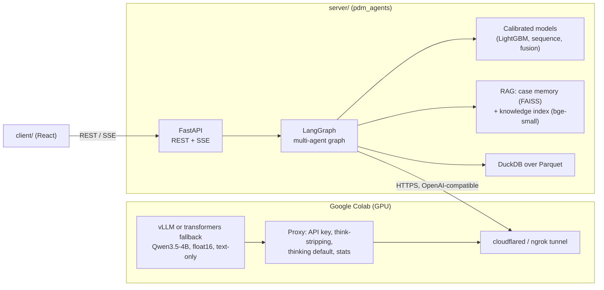
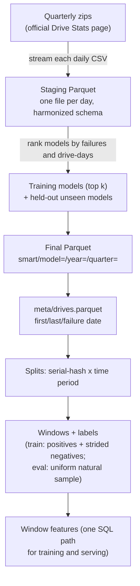
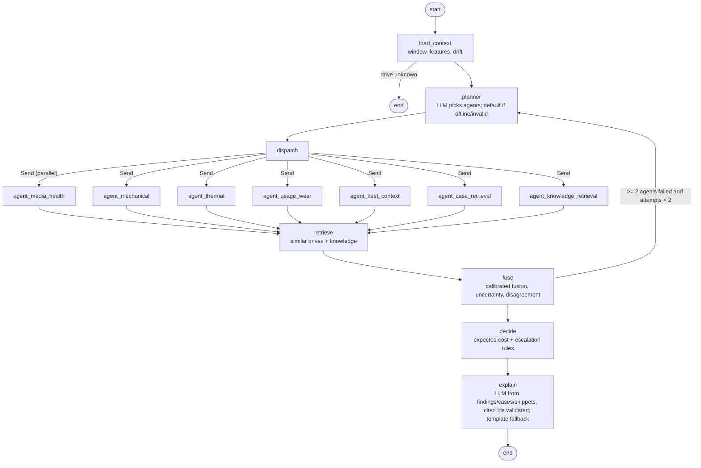
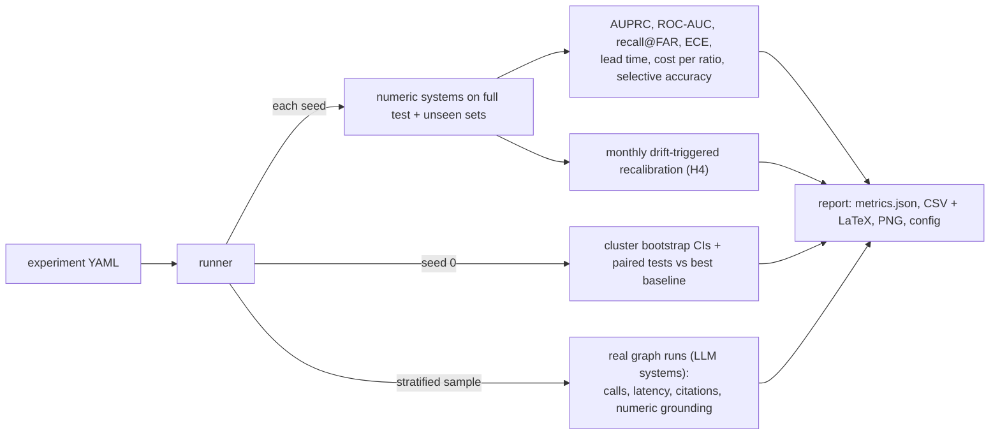

# Architecture

## System overview



**Principle:** Python tools and trained models compute every number. The LLM plans, interprets and explains, and never sees raw SMART rows or does probability math.

## Data pipeline (`data/`)



- **Harmonization** (`harmonize.py`): only the configured SMART columns are read. Columns a quarter lacks become nulls; every SMART value is stored as float64. Zips are never extracted to disk.
- **Labels** (`labels.py`): `y_h = 1` if the failure row falls 1..h days after `as_of`. A label is null (censored) if the drive left the fleet without failing. Windows on or after the failure day are excluded.
- **Splits:**
  - Serials are md5-hashed into train/val/test, so no serial appears in two splits.
  - Each split samples only from its own time period, and only when every label horizon closes inside that period.
  - Held-out models form the `unseen` split.
- **Features** (`features.py`): for each SMART column in an agent family: last, delta, slope, acceleration, max, number of increases, and days since first non-zero. Per-drive-model robust normalization is fit on training data.

## Models (`models/`)

| Artifact | Fit on | Notes |
|---|---|---|
| LightGBM per family × horizon | train (early stopping: serial-grouped 15% of train) | one per numeric agent |
| LightGBM global × horizon | train | all features (baseline + single-agent risk) |
| Sequence 1D-CNN / LSTM | train (capped windows) | multi-horizon, masked loss |
| Calibrators (isotonic / Platt) | validation, 5-fold serial cross-fitting | out-of-fold outputs feed fusion |
| Fusion (stacking, log-odds, majority) | validation (out-of-fold calibrated risks) | missing agent → imputed with prior |
| Case-risk calibrator + retrieval-aware fusion | validation (kNN against train-only case memory) | `scripts.index` |
| Base rates, drift reference | validation (natural distribution) | pooled values for unseen models |

Probabilities are forced to be non-decreasing in the horizon (running maximum).

## LangGraph orchestration (`graph/`)



- One `agent_<name>` node per enabled agent in `agents.yaml`; the builder names no agent.
- Findings merge through an `operator.add` reducer. On a replan, the newest finding per agent wins.
- Run-time dependencies (resources, LLM session, agents for this run) are passed as LangGraph `context`, so they are not checkpointed. State is checkpointed in SQLite, keyed by run id; finished runs and feedback go to `runs.sqlite`.
- `PredictionEngine.stream` yields graph updates for the SSE endpoint and the UI timeline.

### Specialist agent contract (`agents/base.py`)

```mermaid
sequenceDiagram
  participant G as graph
  participant A as SpecialistAgent
  participant T as tools (no LLM)
  participant L as LLM
  G->>A: run(context, llm)
  A->>T: run_tools: trend_analysis, family_risk / case_risk / knowledge
  T-->>A: ToolEvidence (metrics, evidence ids, calibrated risk)
  A->>L: interpret(evidence) - JSON schema prompt
  alt valid JSON (or after one repair)
    L-->>A: AgentInterpretation
    A-->>G: AgentFinding status=ok
  else LLM down / invalid
    A-->>G: AgentFinding status=degraded (template summary)
  end
  Note over A,G: any exception becomes status=failed; run() never raises
```

### LLM client (`llm/`)

- `ChatOpenAI` pointed at the Colab endpoint, with `extra_body.chat_template_kwargs.enable_thinking=false`.
- Every response is stripped of `<think>` blocks.
- Structured output: the JSON schema goes in the prompt, the reply is parsed with a balanced-brace extractor plus `PydanticOutputParser`, and one repair prompt is tried before falling back. `with_structured_output` is used only when the backend enforces JSON schemas (detected at startup).
- A per-run session counts calls. After the first connection failure it stops calling the LLM for the rest of that run.

## Decisions (`decision/`)

- `E[a] = fixed_cost(a) + exposure_fraction(a) · P(fail ≤ exposure_horizon(a)) · cost_ratio` (see `configs/actions.yaml`).
- Escalate to a human when uncertainty or agent disagreement exceeds its threshold, or when drift (PSI against the validation period) is at alert level.
- Drift is computed per drive model and date from a sample of that model's drives. It uses no labels.

## API (`api/`)

`/health`, `/settings` (GET/PUT, plus `/settings/test`), `/drives` (+ `/drives/stats`, `/drives/{serial}`), `/predict`, `/predict/stream` (SSE: `start`, `update`…, `result`), `/runs/{id}`, `/experiments` (+ `/{id}`; plots served under `/reports`), `/feedback`, `/escalations`. Long jobs are CLI scripts.

## Evaluation (`evaluation/`)



| Hypothesis | Comparison |
|---|---|
| H1 specialists beat a single agent | `multi_agent_no_rag` / `full_system` vs `lgbm_global` / `single_llm_agent`; also `no_<agent>` ablations |
| H2 retrieval helps | `full_system` vs `no_case_retrieval` (prediction); `no_knowledge_retrieval` (explanation metrics in graph runs) |
| H3 calibrated fusion + abstention reduce cost | `full_system` vs `majority_vote`, `no_calibration`, `no_cost_policy`; cost with and without escalation |
| H4 drift-aware recalibration stabilises performance | `full_system` vs `no_drift_recalibration` on the later period and the unseen model, monthly table |
